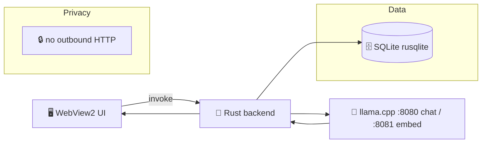

# JournalFriends - Personal Desktop Diary

<p align="center">
  
</p>

> **Private, offline-first Windows desktop app** combining a plain-text journal, a
> full task manager, and a local AI assistant powered by **llama.cpp**. Everything
> runs on your machine — no cloud, no subscriptions, no data leaves. 🛡️

[](https://github.com/shahriarhaqueabir/JournalFriends/actions/workflows/quality.yml)
[](https://opensource.org/licenses/MIT)
[](https://v2.tauri.app/)
[](https://www.rust-lang.org/)


---

## Fun things you can do

- Write a private journal that no one - not even the cloud - can read
- Let the AI propose tasks based on your entries, but you approve every one
- Ask the AI to summarize your week - it never writes, only proposes

## 🎬 The story — why this exists

Most journaling and task apps are cloud-first: your private thoughts live on
someone else's server, behind a subscription, and break the moment Wi-Fi drops.
Arnold inverts that. It is a **single SQLite file on your machine** plus a
local llama.cpp engine that reads your journal, extracts tasks, and answers
questions — with zero network calls. The goal: a diary that is _yours_, that
works offline, and that quietly turns writing into action. 📓✨

> 💡 **The one sentence that drove everything:** _Your thoughts stay on your
> machine, and the AI works for you, not for a vendor._

---

## 🔁 The feedback loop (zero → finished)

```
  1. 📝 JOURNAL    write a plain-text entry
  2. 🔍 ANALYZE    local AI extracts actionable tasks (background)
  3. 📥 INBOX      proposals land in the Review Inbox
  4. 👀 REVIEW     human accepts/rejects each proposal
  5. ✅ COMMIT     accepted items become tasks/events/notes
  6. 📓 AUDIT      every mutation tracked locally
  7. 🔁 REPEAT     next entry, next day
```

> 🧠 **Secret of the loop:** the AI _never writes directly_. Every change is a
> proposal you accept. That single rule is what makes "local AI" trustworthy.

---

## 🏗️ Architecture — how the pieces talk



| Component        | Responsibility                      | Key location                   |
| ---------------- | ----------------------------------- | ------------------------------ |
| 🖥️ Desktop shell | Tauri v2 window + WebView2          | `src-tauri/`                   |
| 🦀 Backend       | DB, AI orchestrator, migrations     | `src-tauri/src/`               |
| 🎨 Frontend      | Vanilla HTML/CSS/JS, charts, kanban | `src/`                         |
| 🗄️ Database      | SQLite (bundled-full)               | `data/` (created on first run) |
| 🤖 AI engine     | llama.cpp chat + embed services     | managed by app                 |

See `AgentDocs/` for detailed specs and blueprints.

---

## 🏆 Good choices (and why they were good)

1. **🔒 Private by construction.** Single SQLite file, no account, no sync.
   Nothing leaves the machine.
2. **🤖 Local AI with confirmation-gated writes.** The AI proposes; you
   accept in the Review Inbox. It never mutates data directly.
3. **📦 Offline installer.** WebView2 is bundled offline; setup never
   downloads anything.
4. **🧩 Two model roles, clearly separated.** Chat role (instruct GGUF) for
   chat/analysis/tools; embedding role (Nomic) only for semantic search. An
   embedding model is rejected in the chat slot.
5. **📁 Data next to the executable.** `<app dir>/data/` holds DB, logs,
   models, backups. `ARNOLD_DATA_DIR` overrides for tests. No hidden
   `%APPDATA%` surprises.
6. **🛡️ No outbound networking.** No URL-fetch, web-search, or download tool
   exists. CSP allows no remote origins.
7. **📋 Vendored frontend libs.** Chart.js, SortableJS, Floating UI, Lucide
   are local — no CDN, no supply-chain drift.

---

## 📋 The playbook — recreate from zero

### Phase 0 — Scope 🎯

1. One sentence: _"Your thoughts stay on your machine."_
2. Boundaries: no cloud, no account, no direct AI writes, offline-first.

### Phase 1 — Skeleton 🦴

3. `cargo tauri init`, Rust 1.77+ MSVC, Tauri v2.
4. Vanilla frontend (no framework) + SQLite via rusqlite (bundled-full).
5. Tokio async runtime.

### Phase 2 — Data layer 🗄️

6. Migrations in `src-tauri/`. DB lives next to executable.
7. Audit log table for all mutations.

### Phase 3 — AI layer 🤖

8. Bundle llama-server runtime. Manage lifecycle (start/stop/health).
9. Two services: chat :8080, embed :8081. OpenAI-compatible HTTP.
10. Confirmation-gated proposal flow → Review Inbox.

### Phase 4 — Journal → Task pipeline 📓

11. Background analysis extracts tasks from entries.
12. Proposals → accept/reject → tasks/events/notes.

### Phase 5 — Task manager ✅

13. Kanban + list views, subtasks, recurring reminders.

### Phase 6 — Ship 🚢

14. `cargo tauri build`, then `bundle-portable.ps1` for portable zip.
15. Data under `<app dir>/data/` on first launch.

---

## ⚠️ Mistakes to avoid

- 🚫 **Staging the llama.cpp runtime in git.** It's ignored; supply it per
  build workspace.
- 🚫 **Mixing model roles.** Embedding models rejected in chat slot — enforce
  at selection time.
- 🚫 **Hidden data dirs.** Keep data next to the executable; document
  `ARNOLD_DATA_DIR` for tests.
- 🚫 **Direct AI writes.** Always propose → review → accept.
- 🚫 **Assuming WebView2 is present.** Bundle the offline installer.

---

## 🧰 Stack

| Layer            | Technology                     | Why                          |
| ---------------- | ------------------------------ | ---------------------------- |
| 🖥️ Desktop shell | Tauri v2                       | Native window, small binary  |
| 🦀 Backend       | Rust 1.77+ (MSVC)              | Memory safety, single binary |
| 🎨 Frontend      | Vanilla HTML/CSS/JS (ES2022)   | No framework bloat           |
| 🤖 AI engine     | llama.cpp (chat + embed)       | Fully local, no cloud        |
| 🗄️ Database      | SQLite (rusqlite bundled-full) | Single file, portable        |
| ⚡ Async         | Tokio                          | Concurrent AI + DB           |
| 📊 Charts        | Chart.js 4.x (vendored)        | No CDN                       |

## 🚀 Getting started

```bash
# Run in development
cargo tauri dev

# Build
cargo tauri build
powershell -ExecutionPolicy Bypass -File bundle-portable.ps1
```

## 📁 Project structure

- `src-tauri/` — Rust backend, migrations, AI orchestrator
- `src/` — Vanilla JS frontend, layout, components
- `AgentDocs/` — system specs and blueprints
- `data/` — local database storage (created on first run)

## 🔒 Security & privacy

- No cloud, no account, no sync.
- Offline by construction: no web-search, URL-fetch, or download tool.
- Confirmation-gated writes: AI proposes, human accepts.
- Audit logs for all mutations.
- No outbound HTTP except loopback to local llama.cpp.

## 📸 Screenshots

| View 1 | View 2 | View 3 |
|---|---|---|

> Add your own screenshots under docs/screenshots/.

## 📌 TL;DR

- **Problem:** cloud-dependent, subscription-based journals that leak private thoughts.
- **Solution:** Tauri v2 desktop diary with local SQLite + llama.cpp AI, confirmation-gated writes.
- **Why it is interesting:** shows how to build a trustworthy local AI app where the model proposes and the human decides.


## 📜 License

MIT License — Copyright (c) 2026 Arnold.
